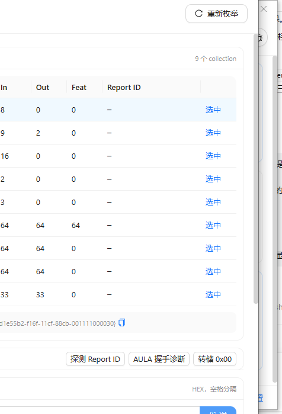

# 2.4G Battery Viewer

Windows 上的 2.4G 无线外设电量监视器。Tauri 2 + React 19 + **Ant Design 5** + Rust。



## 四种形态

| 形态 | 说明 |
|---|---|
| **简洁面板** | 每台设备一张卡片：大号百分比 + 进度条 + 数据来源。顶部显示设备数与平均值 |
| **任务栏** | 停靠在任务栏右侧的一条药丸，显示 `🎧 iKF-V11 Pro 60% │ 🖱 AULA 76%`；宽度随内容自适应，Explorer 重启后自动贴回原位 |
| **悬浮框** | 单行半透明小条，只占一行；大小与不透明度可调；可拖拽，可点 🔒 锁定位置 |
| **完整调试版** | 左侧设备树，右侧：全部 HID 接口表（usage / 报告长度 / Report ID）、Feature Report 转储、Report ID 探测、试发任意命令、跑遍所有协议并手动标定 |

四种形态通过托盘菜单或面板右上角按钮切换，也可用命令行：

```powershell
battery-viewer.exe             # 简洁面板
battery-viewer.exe --taskbar   # 直接嵌入任务栏
battery-viewer.exe --float     # 直接显示悬浮框
battery-viewer.exe --debug     # 直接打开调试台
battery-viewer.exe --silent    # 只驻留托盘（开机自启用）
```

### 任务栏形态的实现

任务栏药丸是一个**顶层置顶窗口**，停靠在任务栏右侧、垂直居中于任务栏。

早期实现是把它 `SetParent` 进 `ReBarWindow32` 当真正的子窗口，但那样会有一个致命问题：
**Explorer 重启会连带销毁子窗口**，而 Tauri 又不允许用同一个 label 重建窗口
（`a webview with label 'taskbar' already exists`），结果药丸永久消失。

改成顶层窗口后：

- Explorer 重启不再影响药丸（它不属于 Explorer 的窗口树）
- 看门狗线程每 1.5 秒检查一次位置，任务栏分辨率/位置变化后自动重新停靠
- 用 `WS_EX_TOOLWINDOW | WS_EX_NOACTIVATE` 保证不进 Alt+Tab、不抢焦点

停靠位置的计算（`dock_rect`）：读取 `Shell_TrayWnd` 与 `TrayNotifyWnd` 的矩形，
把药丸贴到托盘左侧、垂直居中。

### 每个形态独立配置显示哪些设备

设置面板里，任务栏和悬浮框各有自己的「显示的设备」多选（`taskbarDevices` / `floatDevices`）：

- 勾选：只显示选中的设备
- 不勾选（默认）：自动显示所有**能读到电量**的设备

悬浮框另有「大小」（80%~180%）与「不透明度」（15%~100%）两个滑杆；任务栏可选字号（小/标准/大）。

## 设置与多窗口同步

- 设置**改动即生效、自动保存**（300 ms 防抖），面板底部和设置抽屉里都有「已保存」提示，
  抽屉底部还有「完成 / 恢复默认」两个按钮
- 写入是**原子替换**（先写 .tmp 再 rename）并加锁串行化，不会出现写坏 JSON / 丢设置
- 任何窗口改了设置，后端都会广播 `settings://changed`，其余窗口立刻跟随；
  悬浮框和任务栏另外每 2 秒轮询一次 `get_settings` / `get_snapshot` 兜底
  （这两个窗口是在隐藏状态下创建的，事件监听偶尔注册不上）

## 其他功能

- **自动刷新**：2 秒 ~ 1 小时可调，默认 30 秒；写入设置后立即生效
- **开机自启**：写 `HKCU\Software\Microsoft\Windows\CurrentVersion\Run`，当前用户级、不需要管理员权限
- **低占用**：单个后台线程按间隔轮询；能读到电量的设备记住协议（`protocol_cache`），
  完全读不到的设备暂停探测 5 分钟（`give_up_until`），避免持续空转。
  实测常驻内存 22 MB，空闲 CPU 0.1 秒/分钟
- **低电量提醒**：阈值可调（默认 15%），通过 Tauri 事件通知前端

## 协议支持

| 协议 | 触发条件 / 说明 |
|---|---|
| Logitech HID++ 2.0 | `0x1004` 统一电量 → `0x1000` → `0x1001` 电压；接收器槽位 1..6 与 0xFF 都试 |
| Logitech HID++ 1.0 | 寄存器 `0x0D`（百分比，掩码 0x7F）/ `0x07`（档位） |
| Razer Synapse | 90 字节 Feature，命令类 0x07 / id 0x80，异或校验，transaction id 依次试 0x1F/0x3F/0xFF |
| Nordic 52840 / Compx | 17 字节 Report 0x08、子命令 0x04，校验和 = 全部字节和 0x55（ATK/VXE/VGN/Zaopin/Pulsar/Kysona…） |
| Nordic 54L15 | 64 字节、命令 0x72（ATK Zero），电压小端 |
| **AULA WebHID** | 逆向自官方网页驱动：Report **0x55**、63 字节，`payload[0]=0x65` 查询电量，回复 `[0x65, 电量, 状态]`，状态 0x03/0x04 为充电 |
| C-Media `55 65` | 顺带发送 `55 65 00` 初始化 + `55 65 01` 查询；关键是用 **HidD_GetInputReport 轮询**读取（很多耳机不产生中断上报），Report ID 可能是 0xFD / 0xBC |
| MCHOSE | 64 字节 Report 0x55（usage page 0xFF90） |
| Realtek 推送式 | Report 0x13 / 子类型 0x1D，负载异或 0xFF |
| SteelSeries | `06 18` / `00 B0` / `06 B0`；Nova 系列兼容 0–8 与 0–100 两种刻度 |
| HyperX / Corsair / Glorious / A4Tech | 各自厂商命令 |
| 标准 HID 电量 | Usage `0x06:0x20` / `0x85`，Feature 与 Input 都试 |

协议选择顺序按 VID 决定，最后统一兜底；**手动标定**会写入 `settings.json` 的 `overrides`，优先于自动判断。

## AULA 鼠标电量协议（逆向自官方网页驱动）

来源：https://hub.aulacn.com/mouse/keySet ，用 CDP 向页面注入 WebHID 钩子，
直接记录网页驱动调用的 `sendReport` / `receiveFeatureReport` 与 `inputreport` 事件。

### 通道
| 项 | 值 |
| --- | --- |
| Usage Page | `0xFFA8` |
| OUT Report ID | `0x0B`（64 字节） |
| IN Report ID | `0x0A`（64 字节） |

### 电量查询
```
发送  sendReport(0x0B, [0x81, 0x00])
接收  inputreport(0x0A): [0x81, len, payload...]
```

`payload` 布局（`len = 0x2F`）：

| 偏移 | 含义 |
| --- | --- |
| 0..14 | 设备信息（MAC、型号等） |
| **15** | **电量百分比** |
| **16** | **充电标志**（0 = 放电，非 0 = 充电中） |
| 17.. | 保留 |

实测回包：
```
0a 81 2f 00 05 33 98 34 5e 0c d0 40 01 19 01 00 00 00 47 00 01 00 ...
                  └──────────────── payload ────────────────┘
                                                ▲
                                          0x47 = 71%
```

### 其他已确认命令
| 命令 | 回包长度 | 含义 |
| --- | --- | --- |
| `[0xA0, 0x00]` | 0x13 | 固件版本 |
| `[0x83, 0x00]` | 0x16 | 设备能力位 |
| `[0x85, 0x00]` | 0x27 | DPI / 性能 |
| `[0xC4]` / `[0xD0]` | 0x02 | 状态短包 |

> 注意：0xFFA8 通道对 **0x55/0xAA 长帧**只会原样回显，网页驱动并不使用它。
> 真正的电量查询是上面这条两字节短命令。

## 本机实测结论（2026-10-20 更新）

| 设备 | 结果 |
|---|---|
| **iKF-V11 Pro (0E6A:0110)** | ❌ **读不到电量，固件未提供**（2026-10-23 复核）。之前显示的 60% 是误判：厂商通道 0xBC/0xFD 报告是一串**固定数据**，连发 12 种不同命令、连续轮询 5 秒，一个字节都不变（0xBC = `00×16 01 55 01 03 3C 10 01 06 00×8`）。0x3C 被当成 60%，其实是静态块。厂商自己的 XearONE 里虽有 `RefreshPanelBattery`/`BatteryInfoLost` 和 0/25/50/75/100 电量图标，但 CmHIDSDK 里没有任何 battery API |
| **MCHOSE Mix 87-III (3837:300D)** | ⚠️ 厂商接口对 0x55/0xAA 帧回 `unknw`（命令未识别），对 0x55/0x65 回 `cserr`（校验错）| 
| **AULA Receiver (38A6:28F9)** | ✅ 读到电量（实测 **71%**，与官方网页完全一致）。网页驱动用 **0xFFA8** 通道的短命令：`sendReport(0x0B, [0x81, 0x00])` → 回 `inputreport(0x0A): [0x81, len, payload…]`，**`payload[15]` 就是电量百分比，`payload[16]` 是充电标志**。已用 CDP 注入 WebHID 钩子抓取网页真实收发字节确认（`OUT 0x0B: [129,0]` → `IN 0x0A: [129,47,0,5,51,…,71,0,1,…]`，`47`=71%）。其余命令：`0xA0` 固件版本、`0x83` 能力位、`0x85` DPI、`0xC4/0xD0` 状态 |

后两台设备仍可在调试台里「试发命令」继续逆向，找到正确报文后用**手动标定**绑定到任一协议即可。

> iKF-V11 Pro 补充：HID 描述符里只有 0x000C:0x0001 一个 collection（消费控制），
> 厂商页 0xFF02 下的报告 ID 0xBC / 0xFD 全静态；Windows 也没把它识别成电池设备
> （没有 Battery 类节点，`Win32_Battery` 为空）。**2.4G/USB 这条路上拿不到电量。**
> 唯一还有戏的是蓝牙模式 —— BLE 设备通常带标准的 Battery Service（0x180F/0x2A19）。

## 已修复的坑（2026-10-22）

| 现象 | 根因 | 处理 |
|---|---|---|
| 鼠标消失 | 测试时把设备写进了 `hidden`，而 `rescan` 直接把隐藏设备从列表里删掉，界面上再也看不到、无法恢复 | 隐藏设备保留在快照里（`hidden` 标记），面板底部出现「已隐藏 N 台设备 / 恢复显示」 |
| 打开调试台就卡死 | Tauri 同步命令跑在 UI 线程上，而所有 HID 操作共用一把全局 `Mutex<HidApi>`，轮询线程读一轮要好几秒，调试台一进来就被堵死 | 所有碰 HID 的命令改成 async + `spawn_blocking`；去掉全局锁，改成每次操作新建 hidapi 实例 |
| Report ID 探测永远转圈 | 系统独占的鼠标 collection 不回 Feature 请求，`HidD_GetFeature` 卡在驱动里 | 探测放到独立线程、最多等 4 秒；Feat=0 的接口直接提示跳过；读 Feature 也加 3 秒硬超时 |
| 设置改了没反应 | 每个窗口各自持有一份设置，改完只更新自己；小窗还是隐藏状态创建的，事件监听可能压根没注册上 | 广播 + 小窗 2 秒轮询兜底；保存加防抖与「已保存」提示 |
| 任务栏药丸跑到屏幕顶部 | `relayout()` 还在用「子窗口相对父窗口」的坐标，`SetParent` 早就去掉了 | 统一改用屏幕坐标 `dock_rect()`（读 `Shell_TrayWnd` / `TrayNotifyWnd`） |
| 双击图标没反应 | 单实例检测到已有进程就静默退出 | 弹一个提示框告诉用户程序已在托盘运行 |
| 开机自启后小窗不见了 | `--silent` 把整个 restore 流程也跳过了 | `--silent` 只隐藏主面板，任务栏药丸与悬浮框照常恢复 |
| **任务栏电量不刷新** | 三个问题叠在一起：① `capabilities/default.json` 的 `windows` 只有 panel/float/debug，任务栏窗口的 `plugin:event\|listen` 被 ACL 拒绝，广播全被丢掉；② `SnapshotEvent` 没写 `serde(rename_all = "camelCase")`，前端拿到的是 `refreshed_at`，按 `refreshedAt` 比时间永远相等；③ `Taskbar.tsx` 用的是 `own ?? outer`，self 轮询一旦赋值 outer 就被永久屏蔽 | ① 能力表补上 `taskbar`；② 快照结构体加 camelCase 序列化；③ 改成按 `refreshedAt` 取两者中更新的一份（`useMemo`） |

## 托盘图标与任务栏按钮

程序只在**系统托盘**保留一个图标（⚡），面板、悬浮框、任务栏药丸、调试台**都不占任务栏按钮**：

- 托盘图标由 `setup_tray()` 用 `TrayIconBuilder` 创建，带右键菜单
- `tauri.conf.json` 里的 `app.trayIcon` 必须留空 —— Tauri 会为它自动再建一个托盘图标，
  两个同款图标叠在一起（早期就是踩了这个坑，托盘里出现两个 ⚡）
- 窗口统一 `skipTaskbar(true)`，避免"托盘一个图标 + 任务栏一个按钮"看起来像两个程序

如果托盘里看不到 ⚡，它多半被 Windows 收进了任务栏的 ⌃ 溢出区，拖到任务栏上即可常显。

## 界面约定

- **所有图标都来自 `@ant-design/icons`**，不用 emoji、不画自绘 SVG；设备类型统一走 `src/icons.tsx` 的 `deviceIcon()`
  （鼠标 Aim、键盘笔记本、一体机桌面、耳机客服、接收器 USB）
- **调试台和设置用不同图标**：调试台 `BugOutlined`，设置 `SettingOutlined`
- **悬浮框按钮不带 Tooltip**：气泡会盖住按钮、抢走点击，三个按钮改成纯图标 + 固定热区
- **任务栏药丸无背景**：只渲染内容（名称 + 电量），透明底、无边框、右对齐贴住托盘；文字颜色跟随系统深浅色并带 1px 阴影保证可读
- **设备分类先看 collection 再看名字**：2.4G 接收器描述里带 Receiver，但它承载的就是鼠标/键盘，
  因此有鼠标 collection 就判为 mouse（AULA Receiver → 鼠标），只有纯 dongle 才显示成接收器

## 应用图标

图标不是 Tauri 默认的那张了，改成和界面同一套视觉：**渐变圆角方块 + 白色闪电**（就是面板左上角那个徽标）。

```
src-tauri/app-icon.png     ← 1024×1024 源图（圆角方块 #4f9cf9→#7c5cff + antd ThunderboltFilled）
src-tauri/icons/           ← 由 tauri icon 生成：32/128/256 png、icon.ico、icon.icns、StoreLogo…
```

重新生成：

```powershell
npx tauri icon src-tauri/app-icon.png
```

> 坑：光换 `icons/` 里的文件不够。Tauri 的 build script 会把图标写进 `OUT_DIR` 缓存，
> 不声明依赖就不会重跑，结果 exe 资源图标、窗口图标、托盘图标全都还是旧的 Tauri 默认图标。
> 所以 `build.rs` 里加了：

```rust
println!("cargo:rerun-if-changed=icons");
println!("cargo:rerun-if-changed=tauri.conf.json");
```

安装包（NSIS）的图标另外配：`bundle.windows.nsis.installerIcon = "icons/icon.ico"`。

## 开发

```powershell
npm install
npm run app:dev      # 开发模式
npm run app:build    # 打包（生成 NSIS 安装包）
```

Rust 侧需要 MSVC 工具链：Visual Studio Build Tools 的「使用 C++ 的桌面开发」+ Windows SDK。

## 目录

```
src/                        前端（React + TypeScript）
  views/Panel.tsx           简洁面板
  views/Float.tsx           悬浮框（拖拽 / 锁定 / 位置持久化）
  views/Debug.tsx           完整调试版
  components/BatteryCard.tsx
  api.ts / types.ts         Tauri 命令封装与类型
src-tauri/src/
  winapi.rs                 最小 Win32 FFI（setupapi / hid / advapi32 / kernel32）
  hidwin.rs                 HID collection 枚举、预解析数据、GetInputReport 轮询
  scan.rs                   设备归组（VID/PID + 父设备哈希）与分类
  engine.rs                 轮询引擎：协议缓存、失败退避、事件广播
  proto/                    各厂商协议
    hidpp.rs razer.rs nordic.rs aula.rs cm.rs steelseries.rs generic.rs
  commands.rs               Tauri 命令
  autostart.rs              注册表自启
  windows.rs                三形态窗口管理
  store.rs                  设置持久化（容错 BOM）
```

> 附：`../HID-battery-protocols.md` 是各厂商 HID 电量协议的调研资料（含出处与可信度分级）。